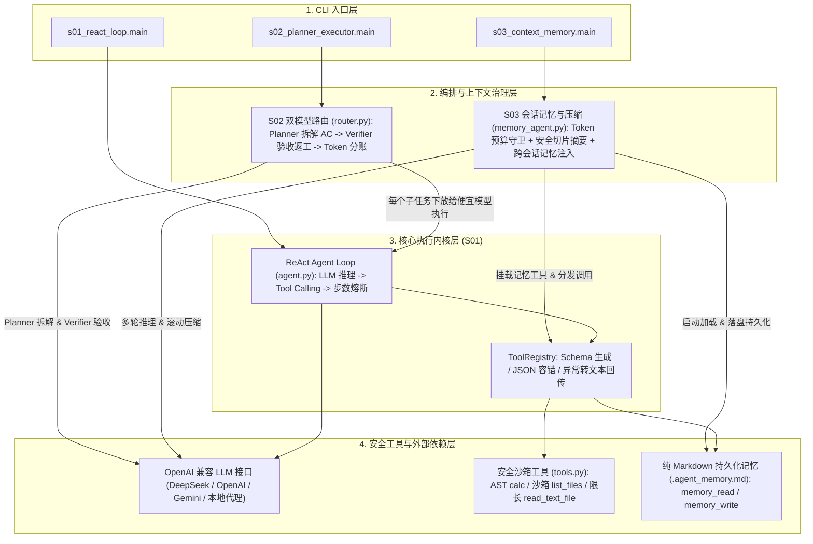
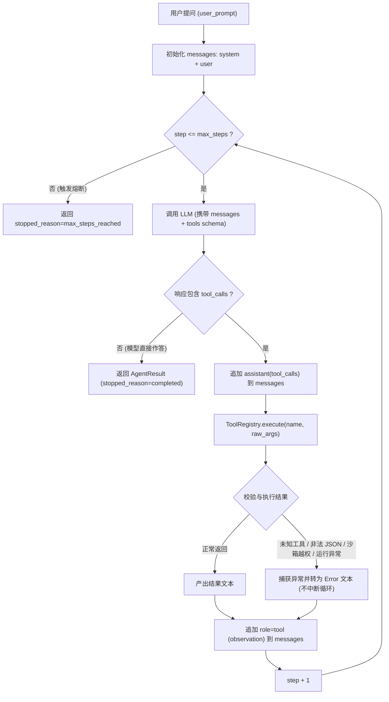
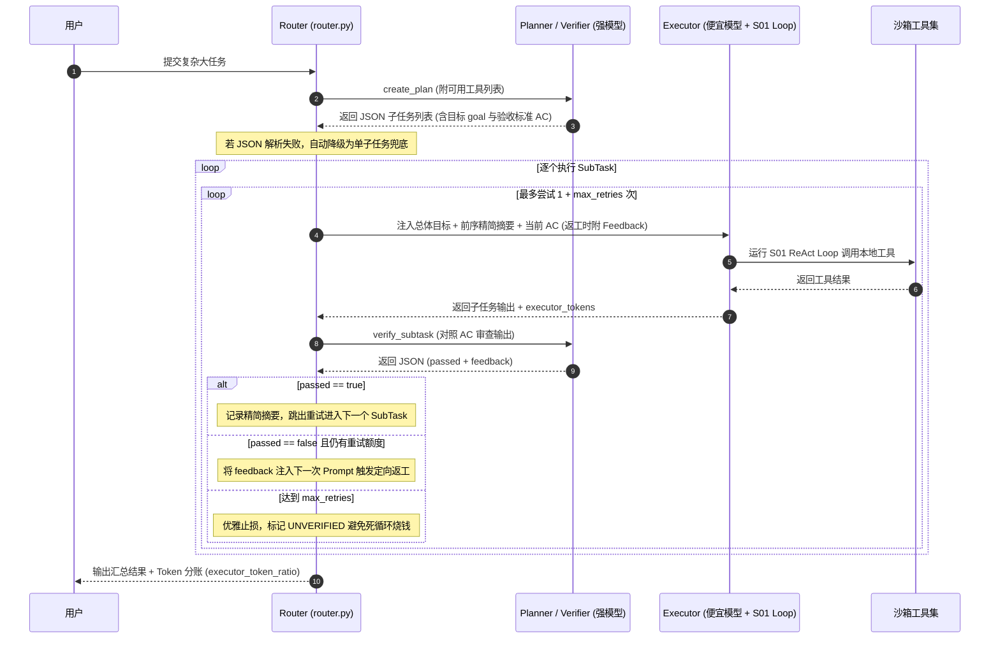
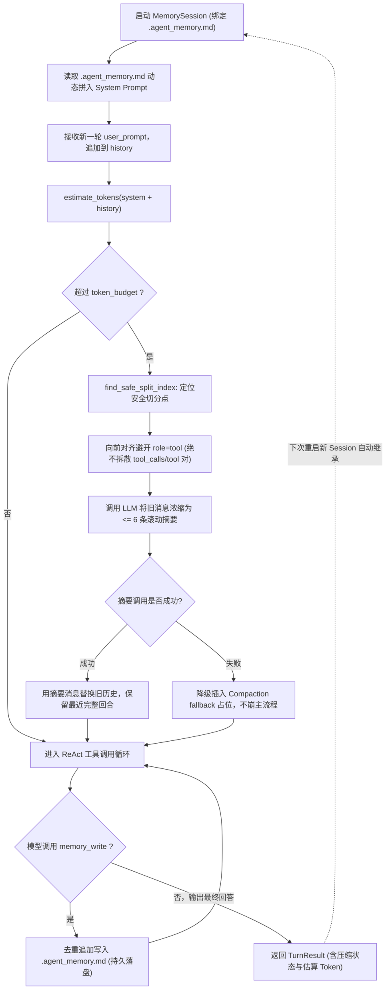

# mini-agent-lab

不依赖重型 Agent 框架，从零手写一系列**最小可运行（Minimal Viable Example）**的 AI Agent 工程实验。

聚焦真正决定 Agent 生产可用性的底层工程问题：**ReAct 控制循环、工具安全围栏、强弱模型路由降本、上下文预算压缩、跨会话持久化记忆与离线回归测试**。每个实验模块彼此组合复用、代码克制可读，且配套零 API 消耗的离线单元测试。

---

## 一、整体运行架构

整个项目采用**分层组合架构**：`S01` 是最底层的执行内核与安全工具注册表，`S02` 直接复用 `S01` 的循环作为子任务执行器，`S03` 在 `S01` 工具体系上叠加预算守卫、滚动压缩与纯文本长期记忆。



---

## 二、目录结构与演进路线

```text
mini-agent-lab/
├── s01_react_loop/               # [S01] 最小 ReAct Loop + 工具注册容错 + 沙箱工具
│   ├── agent.py                  # 核心循环 (~140 行)：ToolRegistry + run_agent + max_steps 熔断
│   ├── tools.py                  # AST 白名单计算器 + 防路径穿越沙箱文件工具
│   └── main.py                   # 单次任务 CLI 入口
├── s02_planner_executor/         # [S02] 强弱双模型路由（规划/执行/验收返工）
│   ├── router.py                 # create_plan + verify_subtask + run_pipeline + Token 分账
│   └── main.py                   # 支持同厂商或跨厂商双模型 CLI 入口
├── s03_context_memory/           # [S03] 上下文自动压缩 + 纯 Markdown 跨会话记忆
│   ├── memory_agent.py           # FileMemory + 安全边界切片 + compact_history + MemorySession
│   └── main.py                   # 支持多轮交互与重启验证的 CLI 入口
├── tests/                        # 零 API 费用的离线单元测试（FakeClient 依赖注入）
│   ├── test_react_loop.py
│   ├── test_planner_executor.py
│   └── test_context_memory.py
├── .env.example                  # 模型与路由配置模板
└── pyproject.toml                # uv 依赖管理（仅 openai + python-dotenv）
```

| 编号 | 模块 | 解决的核心工程问题 | 状态 |
| :--- | :--- | :--- | :--- |
| **S01** | `s01_react_loop/` | 脱离重框架手写最小 ReAct 闭环、工具异常自修复、沙箱越权防护、步数熔断 | ✅ 已完成 |
| **S02** | `s02_planner_executor/` | 强模型只做拆解与验收、便宜模型承担高频工具调用，量化 Token 卸载降本比例 | ✅ 已完成 |
| **S03** | `s03_context_memory/` | 长对话超预算自动滚动摘要（不拆散 `tool_calls/tool` 对）+ 跨会话 Markdown 长期记忆 | ✅ 已完成 |
| **S04** | `s04_evals/` | 离线 Golden Dataset 回归评测（工具准确率 / 任务完成率 / 成本波动对比） | 🚧 计划中 |

---

## 三、核心运行过程流程图

### 1. S01 · 最小 ReAct Loop 运行过程

展示一次完整请求如何在 `run_agent` 中循环推进，重点是**工具异常不崩进程（转为 Observation 回传给模型自修复）**以及 **`max_steps` 强制熔断**。



---

### 2. S02 · 双模型路由（Planner + Cheap Executor + Verifier）运行过程

核心思路是**权责分离 + 上下文隔离**：强模型只负责最值钱的「定计划」和「把关验收」，繁琐的多步工具调用全部交给便宜模型；且每个子任务只看前序精简摘要，避免 Token 滚雪球。



---

### 3. S03 · 上下文自动压缩 + 跨会话文件记忆运行过程

解决长对话越跑越慢、上下文溢出和「关闭窗口就失忆」三个痛点。



---

## 四、关键工程取舍与避坑笔记

1. **为什么工具异常一律转成字符串回传，而不是直接 `raise`？**
   真实调用中，模型经常传错参数名、拼坏 JSON 或尝试访问不存在的路径。直接抛异常会让整次任务前功尽弃；把明确的 `Error: ...` 当作 `tool` 角色消息喂回上下文，大多数模型在下一步就能自行修正。
2. **为什么 S03 压缩历史时专门写了 `find_safe_split_index`？**
   OpenAI 协议要求每条 `role="tool"` 消息前面必须紧跟包含对应 `tool_call_id` 的 `assistant(tool_calls)` 消息。如果按固定条数硬切（如直接 `history[-4:]`），一旦切口落在 `tool` 消息上，下一次请求必然触发 **HTTP 400 Invalid messages**。向前扫描对齐到非 `tool` 边界是上线前必须补上的防线。
3. **为什么跨会话记忆先用纯 Markdown（`.agent_memory.md`），而不是一上来上向量库？**
   对于个人助手和中小规模项目状态，纯文本文件零基础设施依赖、人类可以直接打开审校纠错、Git 可追踪变更，且无 RAG 切块丢上下文的问题；只有当文档量级上千时才值得叠加检索引擎。
4. **为什么所有核心函数都通过参数注入 `client`？**
   把 `OpenAI` 客户端作为依赖传入，不写死在函数内部，离线单元测试只需传入极简 `FakeClient` 就能在 **0.02 秒内**确定性回归所有异常分支（非法 JSON、路径穿越、返工重试、压缩降级），不依赖网络也不烧 API 费用。

---

## 五、5 分钟快速开始

### 1. 安装依赖（推荐 `uv`）

```bash
uv sync
```

### 2. 运行全部离线单元测试（零 API 消耗）

```bash
uv run pytest -v
```

当前覆盖 10 个核心用例：
- `tests/test_react_loop.py`：多步 Tool Calling、未知工具/非法 JSON/目录穿越拦截回传、最大步数熔断
- `tests/test_planner_executor.py`：双模型拆分与 Token 分账统计、验收不通过触发定向返工、重试止损与非法 Plan 降级
- `tests/test_context_memory.py`：跨会话 Markdown 持久化记忆继承、超预算自动滚动压缩、`tool_calls/tool` 安全切分边界、摘要失败降级兜底

### 3. 接入真实模型运行

复制配置模板并填入任意 OpenAI 兼容接口（DeepSeek / OpenAI / Gemini 兼容端点 / 本地代理均可）：

```bash
cp .env.example .env
```

按需运行对应实验：

```bash
# S01：单模型最小 ReAct Loop
uv run python -m s01_react_loop.main "先列出当前目录的文件，读一下 README.md，再算一下 365 * 24"

# S02：双模型路由（可在 .env 分别设置 PLANNER_MODEL 和 EXECUTOR_MODEL）
uv run python -m s02_planner_executor.main "列出目录文件，读 README.md 总结路线图，再计算 141 + 110 + 39"

# S03：多轮交互 + 自动压缩 + 跨会话持久化记忆（试着告诉它你的偏好，exit 后重启再问它）
uv run python -m s03_context_memory.main
```

---

## License

[MIT](./LICENSE)
